# Owenの中古水印工坊

一个**完全本地运行、零依赖**的网页工具：把 JPG / PNG 拖进浏览器，读取完整 EXIF / XMP / IPTC / GPS / ICC 信息，实时预览带品牌徽标的水印，并导出带元数据回写的成片。

> 图片只在浏览器里处理，不会上传服务器。内置品牌为字样徽标（非官方图形商标），可导入自己的 logo。

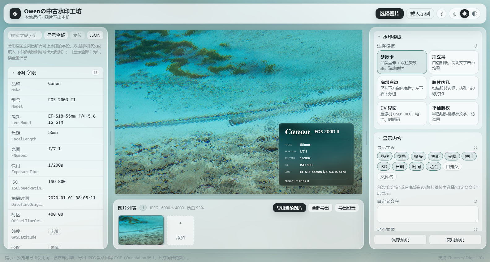

## 快速开始

### 方式 A：直接双击（推荐，无需安装）

双击 [`index.html`](index.html)，用 Chrome / Edge 打开。页面使用传统 `<script>`，`file://` 下可完整运行。

### 方式 B：本地静态服务器

```powershell
node server.mjs
# 打开 http://127.0.0.1:5173/
```

可以通过服务器加载示例：`http://127.0.0.1:5173/?demo=canon-r5.jpg`。

## 功能

### 1. 完整元数据读取（含 PNG XMP）

- **JPEG**：JFIF、EXIF（IFD0 / Exif / GPS / Interop / IFD1 缩略图）、XMP、IPTC、ICC、COM、SOF、量化表 / 霍夫曼表。
- **PNG**：IHDR、PLTE、tRNS、gAMA、cHRM、sRGB、iCCP、pHYs、tIME、eXIf、tEXt / zTXt / iTXt（自动解压）。
- **PNG 只有 XMP 也能显示完整参数**：`tiff:Make`、`tiff:Model`、`aux:Lens`、`exifEX:LensModel`、`exif:FNumber`、`exif:ExposureTime`、`exif:FocalLength`、`exif:ISOSpeedRatings`（RDF 容器）、日期与 GPS 等会映射到水印摘要与「相机/曝光/镜头/时间」分组。
- 已用 `testTruePhoto` 中 Canon / Nikon / Olympus / Panasonic 的 5 张 PNG 与 3 张 JPEG 验证；PNG 的 ISO 来自 `<exif:ISOSpeedRatings><rdf:Seq><rdf:li>800</rdf:li></rdf:Seq></exif:ISOSpeedRatings>`，现在能正确读取。
- 支持搜索字段、双击编辑；损坏 EXIF 只给警告，不崩溃。

### 2. 左侧 EXIF 与底部图片/导出区

- 左侧栏只负责 **EXIF 信息与修改**，卡片从顶栏下沿一直**通高到底**：EXIF 搜索、复位与字段分组；顶部没有拖入框，也不显示内嵌缩略图。
- 常用栏的 4 张卡**默认全部展开**；搜索时只保留命中的卡片并自动展开，其余隐藏。
- **常用栏 = 固定的水印字段清单，分 4 张卡**：相机与器材（品牌/型号/镜头）、曝光参数（焦距/光圈/快门/ISO/曝光补偿/拍摄模式）、文件信息（文件名/拍摄时间/时区/作者/版权）、地理位置（纬度/经度/海拔），共 **17 项**。**不管照片有没有 EXIF、字段值是有效还是空，这 17 行永远在、永远可双击修改/填入**；打开图片时先把全部 EXIF 读出来预填到对应行。空值显示为虚线「未填」占位，填入后水印立刻用新值渲染。修改只作用于界面与水印，**不写回原图、不影响导出的元数据**。曝光补偿与拍摄模式是真实参数：DV 曝光标尺的标记、胶片 Pentax 模式打印的档位/补偿都由它们驱动（缺省为 P / ±0.0）。
- **「显示全部」= 只读全量**：仍按原有分组列出全部 EXIF/XMP/IPTC/ICC 字段，但**只可看、不可改**。工具栏按钮在两者间切换（记在 `wm.exif.v1`）。
- **空状态就是一张 3:2 的空白参考照片**：中间预览区放一张 1200×800（3:2）的空白照片（直角、磨砂质感），**选中的模板会按真实渲染管线画上去**（示例参数展示版式与位置）。注意 3:2 指的是**照片本身**：胶片、拍立得、底部白边会把外框画在照片四周，成品整体再按舞台自适应，所以照片在成品里的占比会变小，这与导入真实照片时完全一致。照片区域保持透明，由下面的磨砂容器透出主题色（深色模式就是深色、浅色模式就是浅色，与其它磨砂卡片一致）；中间的图标与提示文字会**随方块一起等比缩放**，当成整张图片的一部分。方块里保留「拖入一张照片 / 点击选择，或 Ctrl+V 粘贴」提示，整块可点击（也支持 Enter / Space），全页仍可拖入或粘贴。
- **顶栏不再有「选择图片」「载入示例」按钮**：选图入口统一为中间这块模拟照片。
- EXIF 支持**双击值行内修改**：品牌、型号、镜头、光圈、快门、ISO、焦距、日期、GPS、作者、版权等会立即更新水印；其他纯文本行只改面板显示。修改仅影响界面与水印，不写回导出文件元数据。
- **底部栏只有一张「图片列表」卡片**，位于中间列、预览下方（左右侧栏因此各自通高）：
  - 卡片头部左侧是标题「图片列表」+ 数量徽标，中间是灰色的当前导出摘要（默认 `原格式 · 800 × 1200 · 质量 100%`），**右上角是三个按钮：导入照片 / 导出当前照片 / 更多导出设置**；
  - 缩略图**保留原始比例、底边对齐**，只显示图片（悬停出现移除按钮，已修改带小红点），列表末尾不再有「＋ 添加」瓦片。
  - **缩略图同高 96px、底边对齐、无缩放动画**；宽高比 **≤ 3:1 的照片按原比例完整显示、没有黑边**（最长 288px），**超过 3:1 的才在卡片里留上下黑边**，避免一张超长图占满整条底栏。
  - **鼠标滚轮可左右滑动**：图片多到横向溢出时，在底栏上滚轮直接横向滚动（纵向 delta 自动转成横向），不抢占页面滚动。
- **更多导出设置**点开是**背景模糊的弹窗**：格式、质量、尺寸、元数据、文件名模板、ZIP 全部在里面；弹窗底部有 **导出当前照片 / 全部导出** 两个动作（批量导出只在这里），另有「导出预设 JSON」「恢复默认参数」。控件节点在弹窗与隐藏容器之间移动复用，关闭后仍可再次打开。
- **默认导出 = 原格式 + 100% 尺寸 + 100% 质量**：传 JPG 就导出 JPG、传 PNG 就导出 PNG，尺寸不缩放、质量拉满；这套默认值通过一次性迁移写入（`wm.export.defaults.v1`），之后用户在弹窗里的修改不会被覆盖。
- **右侧栏底部**是一条**预设小卡片条**，只有「保存预设」「使用预设」两个按钮；「使用预设」向上弹出浮层列出已保存预设，**最下面一项固定是「导入预设」**。水印模板卡片因此可以一直延长到这条小条之上。
- 右侧参数栏只保留水印参数，不再放导出设置与预设。
- 页面背景改为当前照片的强模糊图层，叠加低饱和照片主题色；所有玻璃卡片带轻微光晕和阴影。
- **中间只剩一张照片**：预览区去掉了模板名/品牌/渲染耗时/对比原图工具栏与尺寸/缩放说明页脚，也没有面板玻璃底、描边与圆角，只保留照片自己的轻微投影，直接浮在模糊背景上。
- 卡片内外间距整体加大（顶栏、参数分区、EXIF 行、底部卡片），呼吸感更强。
- **所有卡片外侧加了一层柔光**：极淡的白色描边高光 + 大范围低透明度投影 + 跟随照片主题色的光晕（`--card-glow`），浅色/深色各有一套参数。
- **预览缩放用鼠标滚轮**：在预览区向上滚放大（最大就是自适应大小）、向下滚缩小（最小 25%）；**双击左键**立即恢复自适应大小。不再有任何缩放按钮。
- **水印模板可以取消选择**：点击模板卡片选中，**再次点击同一张卡片取消选择**（双击也会取消）；不选模板时导出就是原图，不叠加任何水印。
- **底部缩略图防误拖**：图片设为不可拖拽，并且窗口级拖入会忽略来自图片列表内部的拖拽，不会再出现「拖一下照片就重复导入」。
- **DV 全扁平**：OSD 文字、取景框、对焦框、电池、曝光标尺都没有任何投影/光晕，直接平面叠加在画面上。
- **下拉选择栏统一美化**：原生箭头彻底隐藏，改由外层 `.select-shell` 用 CSS 画一个细线箭头（悬停时箭头变色并轻微上移），圆角 12px、细渐变 + 内高光、悬停主题色描边环、聚焦 4px 环；`option` 跟随主题底色。分段按钮（seg）同步为胶囊圆角 + 选中内阴影。
- **右侧栏与左侧栏完全同风格**：每个参数分区都是一张圆角描边小卡片（可下拉），套在右侧大卡片里，与左侧 EXIF 分组视觉一模一样（同样的三角、同样的胶囊计数）。
- 网页 UI 字号整体保持 **1.25 倍**（顶栏、侧栏、EXIF、参数、弹窗、提示），图片上的水印字号不参与缩放。
- 左右侧栏中间保留竖向拖动手柄：拖动实时调整宽度，中间预览区自动适配；双击手柄恢复默认宽度，键盘方向键可微调，宽度保存在浏览器本地。

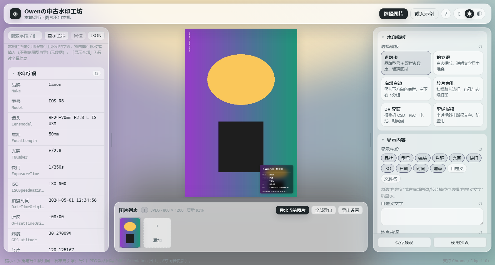
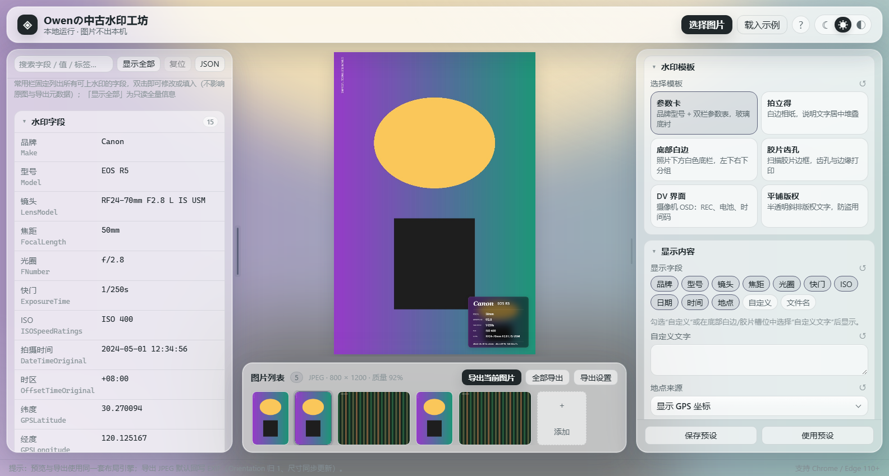

### 3. 六套水印模板

| 模板 | 说明 |
| --- | --- |
| 参数卡 | 品牌型号 + FOCAL / APERTURE / SHUTTER / ISO / LENS 参数表，可选纯色 / 毛玻璃 / 渐变底衬 |
| 拍立得 | 白边相纸，说明文字与品牌居中堆叠 |
| 底部白边 | 照片下方白色底栏，左下 / 右下各 1–2 个可配置槽位；logo 紧邻文字组 |
| 胶片齿孔 | 135 固定比例：白色/黑色齿孔、片长两端各 0.5mm 黑边、真实 Portra 边字/条码、Minolta/Pentax/Canon 打印预设；黑白 / 彩负 |
| DV 界面 | 摄像机 OSD（固定白色）：单折线取景框、REC、分辨率、电池、日期/时间、时间码、曝光标尺、中心对焦框、三分线 |
| 平铺版权 | 半透明斜排版权文字，可调角度、密度、透明度 |


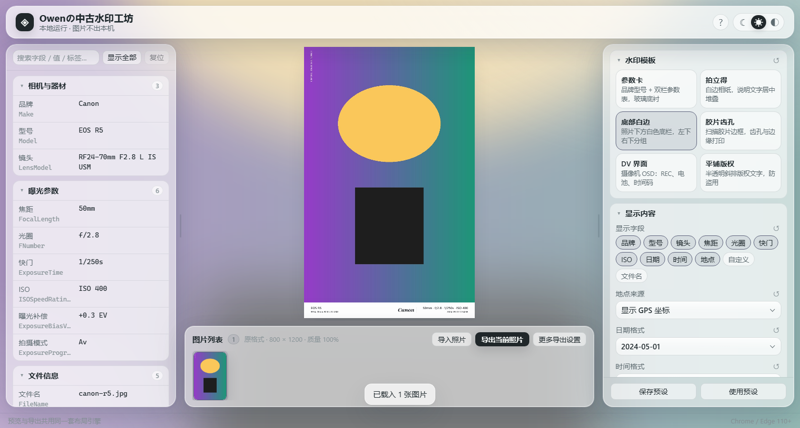

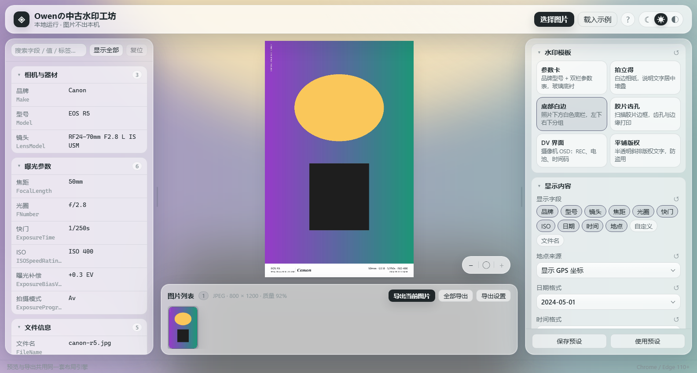

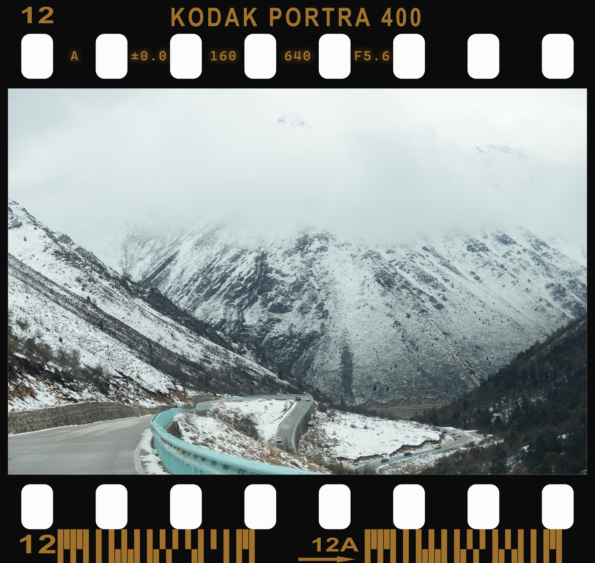

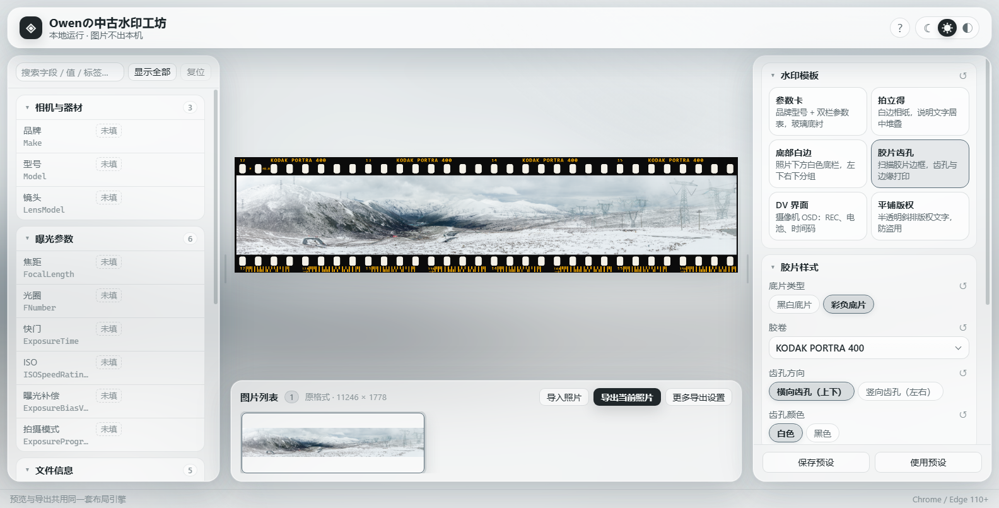


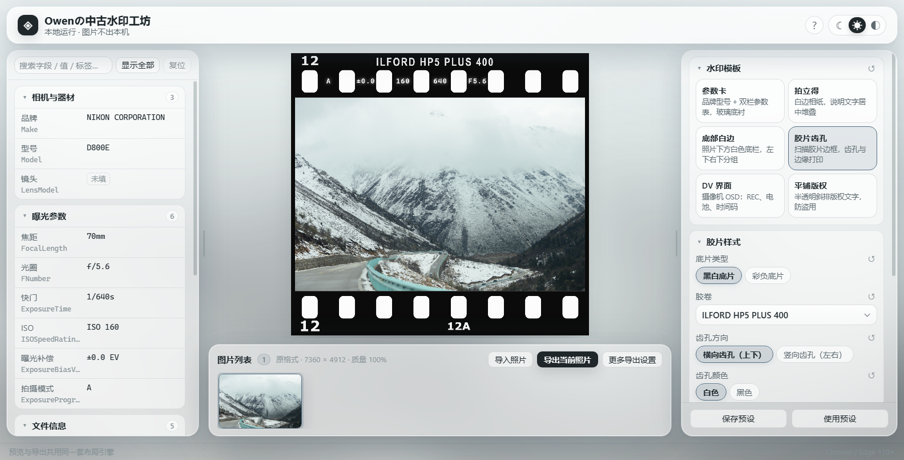

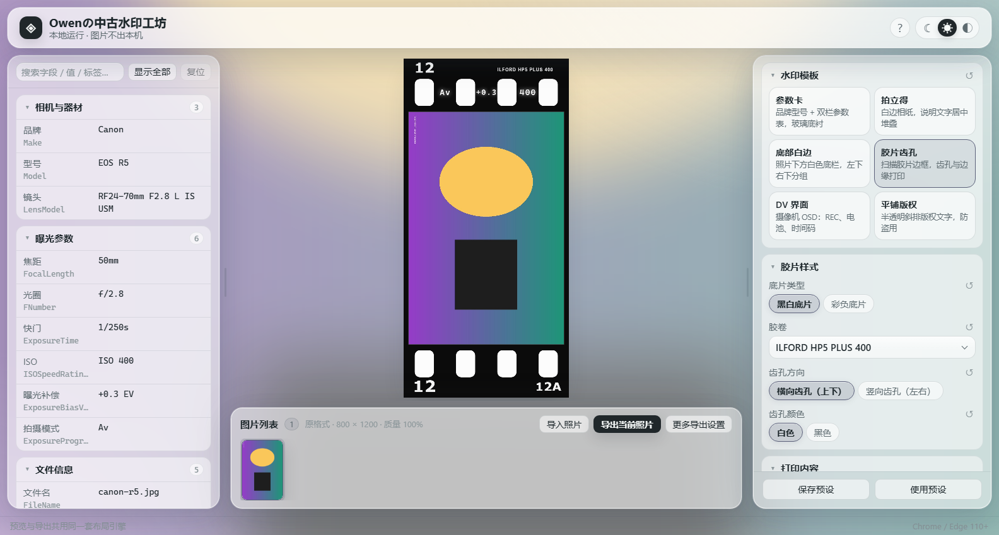

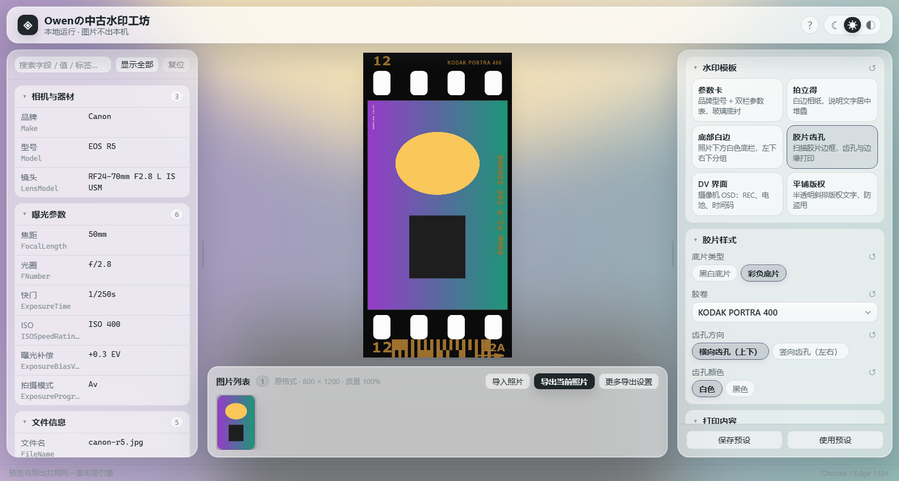


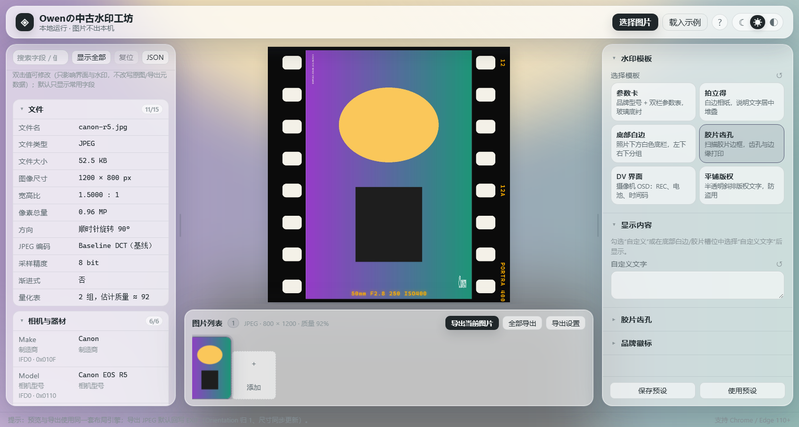

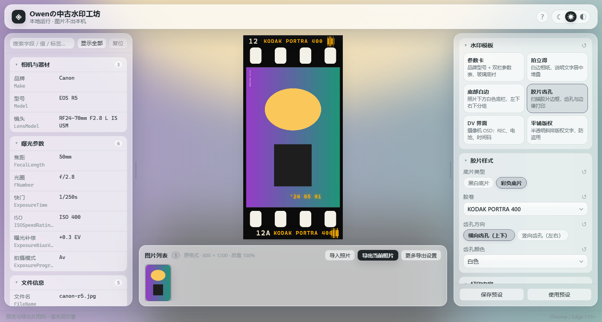


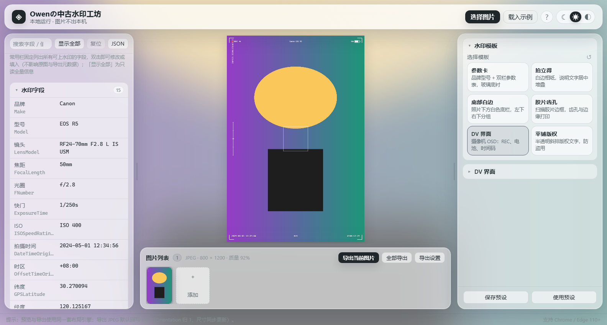

### 4. 胶片齿孔模式

- **黑白底片 / 彩负底片**两种；反转片入口已移除，旧设置会自动迁移为彩负。两种底片都使用近黑片基。
- **胶卷下拉**（胶片样式里，紧跟在「底片类型」下面）：彩负默认 `KODAK PORTRA 400`，黑白默认 `ILFORD HP5 PLUS 400`；选项按底片类型过滤。新增型号时在 `state.FILM_STOCKS` 与 `layout.FILM_EDGE_STYLES` 各加一条，边字样式按型号独立配置，不会影响其它彩负。
- 齿孔方向只有**横向 / 竖向**两项（默认横向），由用户自己选，不再自动切换。
- 按参考扫描图与 135 规格固定比例（以画面高 24mm 标定）：
  - 片宽 = 画面高 × 35/24；
  - 每边片边 5.5mm；
  - **片长两端各多 0.5mm 黑边**（等效 24×36 尺寸下左右各 0.5mm，模拟扫描时多扫一点片基）；
  - 齿孔内缘距画面 **0.6mm**，外侧留出约 2.1mm 边字带；
  - 齿孔固定 **1.98mm × 2.8mm**，长轴垂直于胶卷方向；横向胶卷为竖孔，竖向胶卷为横孔；
  - 齿距 4.75mm，孔数按含黑边的总片长自动取整；3:2 约 8 孔/边，首尾两端都有孔。
- **打印字号只跟 24mm 画幅高成比例**（`‰胶片宽`），与照片宽度无关：同一张照片无论多宽，打印字都一样大；横向/竖向齿孔切换也不改变字号。
- 齿孔颜色可选**白色 / 黑色**，改为和底片类型/齿孔方向一样的**并排分段按钮**，点一次即可切换（不再需要打开下拉）。黑色孔在黑片基上加细浅描边。
- 打印改为**固定风格预设**，不再让用户自由组合字段/位置：
  - **无打印**：只保留齿孔外侧原有边字。
  - **Minolta α9000**：拍摄参数**紧贴画面右缘、垂直居中**竖向排列（横向齿孔时），带亮橙色激光光晕；竖向齿孔时随画幅旋转 90°，贴在下边缘。
  - **Pentax MZS**：上侧齿孔之间，每个孔间隙一个字段，顺序为档位 `P`、曝光补偿 `±0.0`、ISO、快门、光圈（如 `P / ±0.0 / 400 / 250 / F2.8`）。
  - **Canon Prima 80u**：画面右下角日期，格式 `'YY MM DD`，如 `'26 11 16`；竖向齿孔时日期同为竖排。
- 后期打印内容使用高亮近白/亮橙，并带轻微同色光晕，模拟红外激光打印；**打印字号 / 打印透明度只作用于这些打印内容**，不再影响胶片原有边字。
- **原有边字按胶卷型号独立复刻**，不是「换个颜色/换个品牌」通用套用：
  - **Portra 400** 严格按真实 135 的孔位（第 1 孔出片号，第 9 孔出下一片号，即每 8 孔一循环）：
      - 上侧：片号（如 `9`）在**第 1 个上孔正上方**；`KODAK PORTRA 400` 从**第 3 孔左上**到**第 6 孔右上**；第 9 孔开始下一个片号（`10`）。
      - 下侧：片号（如 `9`）在**第 1 个下孔正下方**；第一段条码从**第 1 孔右下**到**第 4 孔下方**；**第 5 孔正下方是 A 片号**（如 `9A`，比普通片号小一点），A 片号下面有**右向箭头**；第二段条码从**第 5 孔右下**到**第 8/9 孔之间**；第 9 孔开始下一个循环。
    - 两段条码内容固定为 `3232303031313031212021302030323` 与 `3232303031313031212031213030323`（各 31 列），逐列渲染：`3` 满高、`2` 上半高、`1` 下半高、`0` 空；每列宽 = 2.66P / 31，列间只有约 0.008P 的轻微缝隙；`0` 与 `1/2/3` 基本同宽，相邻的非 0 列会自然合并成实心块。
    - 条码带从**孔下缘**一直贴到**片边**：满高 ≈0.449P、上半 ≈0.265P、下半 ≈0.184P。
    - 片号使用 **Arial Bold + 1.35 倍横向拉伸**（更扁更宽，`0` 是干净椭圆，`1` 没有底横）；胶卷名使用 **Arial Narrow Bold**。片号、A 片号、胶卷名、条码、箭头全部为暗金 `#A0722D`（接近真实 Portra 边字的 (150,112,44)）。
    - 片号 cap 高度：上侧 0.243P、下侧 0.28P、A 号 0.20P；箭头是**填充多边形**（尖头，不是粗线段），总长 0.77P、杆厚 0.042P、头长 0.25P，贴片边且右端与 A 号右缘对齐。
    - 长图上片号每 8 孔递增，胶卷名与两段条码不断重复；**首尾不内缩、也不把文字压缩进画布**，贴边内容直接允许被片边裁切（竖图/短片上 `KODAK PORTRA 400` 被切断是正常的）。
  - **HP5** 使用自己的白字边字样式（独立的循环、字号与布局，没有 Portra 的橙色条码与箭头），后续可直接按真实 HP5 扫描继续细化。
- 边字字号只由 35mm 片宽决定、透明度固定为 1；**打印字号 / 打印透明度只作用于 Pentax / Minolta / Canon 打印内容**，不影响原有边字。
- 支持下拉选择胶卷与自定义片号起点（默认 `12`）。
- **竖向齿孔 = 整幅旋转 90°**：孔位、原有边字、打印内容一起转，因此任何文字都不会压到齿孔上；旋转后文字锚点按旋转坐标系重算（不存在「竖排文字整体内缩/上移」的问题）。

### 5. 参数面板

- 右侧面板按当前模板自动显示相关区块，不相关区块隐藏：
  - 参数卡：布局 / 底衬 / 文字 / 徽标。
  - 拍立得：相纸厚度与颜色 / 文字 / 徽标；**字重只影响品牌型号行，不改变相纸几何**。
  - 底部白边：栏高 / 栏色 / 左右槽位 / 徽标位置 / 徽标分隔线 / 徽标。
  - 胶片：底片类型 / **胶卷（下拉）** / 方向 / 齿孔颜色（分段按钮）/ 打印风格（无、Minolta、Pentax、Canon）/ 片号起点 / 打印字号（‰胶片宽）/ 打印透明度。
  - DV：字号 / OSD 透明度 / 取景框线 / 取景框线宽 / 取景框边距 / 元素边距 / 分辨率 / 曝光标尺 / 日期时间 / 时间码 / 中心对焦框 / 三分线。**OSD 固定白色，颜色选项已删除**。
  - 平铺版权：字体 / 颜色 / 角度 / 密度 / 透明度 / 字号。
- **日期和时间是独立字段**：显示字段中分别勾选“日期”“时间”；日期有 6 种格式，时间有 24/12 小时制共 4 种格式。底部白边槽位、DV 也遵循同样规则；胶片日期格式由 Canon 预设固定。
- **参数卡品牌去重**：显示品牌 logo 时不再同时打印品牌文字；型号里残留的品牌前缀也会自动剥离。关闭 logo 后恢复“品牌 + 型号”。
- **底部白边 logo**：logo 可在“右侧文字左侧”或“左侧文字右侧”；logo 与相邻文字之间才画细短竖线，没有 logo 时不画任何分隔线。
- **下拉箭头**：所有下拉框使用自定义大号倒三角，随网页字号一起放大。
- **每个可修改项都有 `↺` 复位按钮**，只恢复该项默认值并立即刷新预览；复合控件（模板卡、显示字段、位置九宫格）也有整组复位。
- 所有可见滑块、下拉、开关均实时更新画布；自动化检查逐模板修改 **44 个可见滑块**并验证像素变化与复位（「最大宽度」「徽标圆角」只在特定条件生效，「导出质量」只影响导出文件）。

### DV 细节

- 取景框每个角是**一条折线**（`armEnd → corner → armEnd`，`lineJoin: miter`），转角无缝、无重叠暗块；线宽滑块 1–12‰宽。
- **OSD 透明度拉满就是 100%**：所有图元（文字、线、折线、描边、填充）的 alpha 都等于滑块值，不再有硬编码的 0.16 / 0.72 / 0.8 乘子，满值时不透明。
- REC 红点直径比之前大 25%。

### 6. 界面主题与明暗模式

- 默认浅色玻璃风格：页面背景、面板、输入框、按钮、卡片、EXIF、预览舞台统一使用半透明圆角玻璃与柔和阴影。
- **背景是当前照片的强模糊图层**，上方叠加低饱和照片主题色与浅/深遮罩；没有照片时回退为纯色。
- 所有圆角卡片、图片卡片、预览画布都带轻微光晕和柔和阴影。
- **主题色来自当前照片**：自动提取平均色，转为低饱和 HSL，仅作为界面强调色与背景淡色，不改变水印/导出图片。
- 默认**开灯（浅色）**；顶部栏右上角提供 **黑暗 / 开灯 / 跟随系统** 三段式开关；跟随系统时监听 `prefers-color-scheme`。
- 主题选择保存到 `wm.theme.v1`，刷新后保持；`<head>` 启动脚本提前设置主题，避免刷新闪白。
- 同一套布局与 1.25 倍字号在浅色/深色下保持一致；侧边栏拖动、1080px 单列响应式不变。

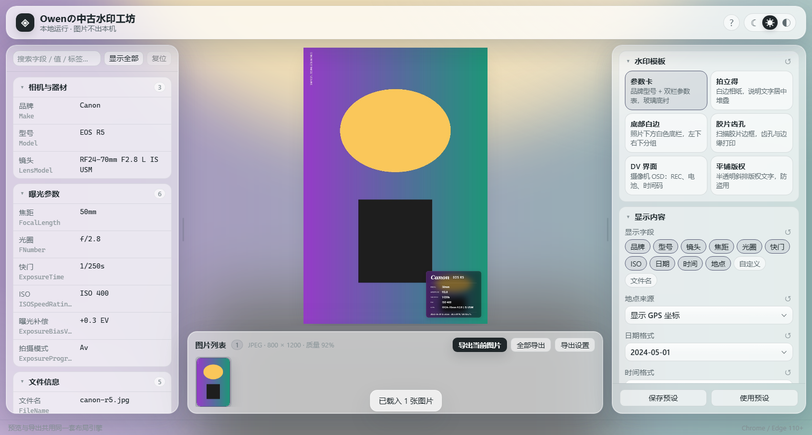

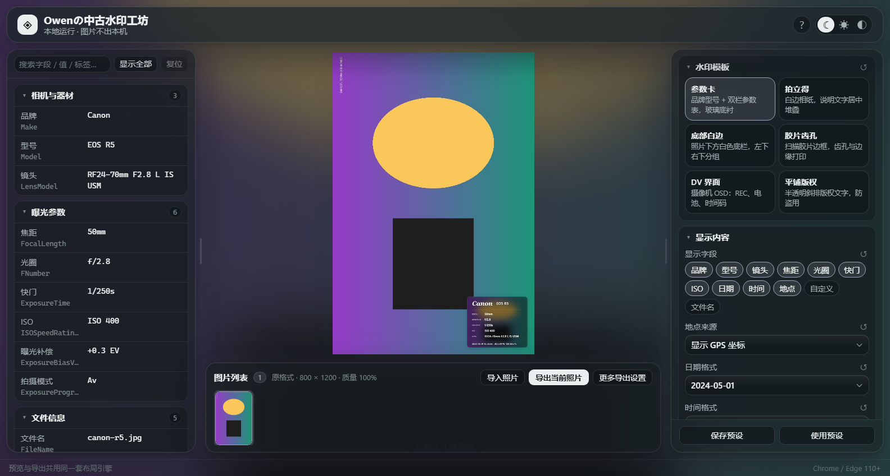

### 7. 文件与导出

- 拖拽、选择、剪贴板粘贴均可；**新拖入的图片自动成为当前预览**。
- 左侧只负责 EXIF；所有已载入图片在底部「图片列表」宽卡片中管理，可点击切换、移除。
- 底部固定「导入照片 / 导出当前照片 / 更多导出设置」；批量导出在导出设置弹窗里；右侧只负责水印参数。
- JPEG / PNG / WebP；质量、原图 / 长边 / 百分比缩放。
- JPEG 导出回写 EXIF（Orientation 归 1、尺寸同步）、XMP、IPTC；PNG 导出保留 / 重建 eXIf、tEXt、zTXt、iTXt、pHYs、tIME；支持 JPEG↔PNG 的 XMP 转换。WebP 暂不支持回写。
- 文件名模板 `{name} {brand} {model} {date} {time} {seq}`；多图 ZIP（UTF-8 文件名），可附 `metadata.json`。
- 预设保存 / 应用 / 导入导出；参数自动保存到 localStorage。

### 8. 快捷键与隐私

- `Ctrl / Cmd + V` 粘贴图片，`Ctrl / Cmd + S` 导出当前图片，`Esc` 关闭弹窗 / 取消导出。
- 除手动点击「联网查询 GPS 地点」（OpenStreetMap Nominatim）外，页面不发起网络请求；图片处理、编码、ZIP 打包都在本机完成。

## 测试

### Node 单元测试

```powershell
node --test --test-isolation=none tests/parser.test.mjs tests/layout.test.mjs tests/export.test.mjs
```

共 48 个测试：XMP 容器（ISO）解析、真实样张摘要、EXIF/PNG 解析、IPTC/XMP/ICC、损坏容错、EXIF 编辑解析、EXIF 补丁与回写、PNG 块重建、跨格式 XMP、ZIP、文件名、尺寸上限、六套模板、胶片固定孔比例/孔向/两端孔/0.5mm 黑边/字号只随 24mm 画幅高/Portra 边字 8 孔循环与孔位相对位置/条码内容与三段高度/边字不受打印控件影响/HP5 独立样式/Minolta 贴右居中/竖向不压孔、DV 单折线取景框/满透明度/固定白色/REC 尺寸、底部白边 logo/短竖线/右对齐、拍立得字重隔离、参数卡品牌去重、日期时间独立格式化、旧设置迁移、EXIF 可见性精简（常用/全部）。

> 受限环境不允许 Node 测试运行器派生子进程，因此使用 `--test-isolation=none`。

### 浏览器自动化

先启动服务器：

```powershell
node server.mjs
```

另开终端：

```powershell
node tests/cdp-check.mjs selftest http://127.0.0.1:5173/tests/browser-selftest.html
node tests/cdp-check.mjs app      "http://127.0.0.1:5173/?demo=canon-r5.jpg"
node tests/cdp-check.mjs file     "file:///E:/code/dshCode/index.html"
node tests/cdp-check.mjs controls "http://127.0.0.1:5173/?demo=canon-r5.jpg"
node tests/cdp-check.mjs features "http://127.0.0.1:5173/?demo=canon-r5.jpg"
node tests/cdp-check.mjs theme    "http://127.0.0.1:5173/?demo=canon-r5.jpg"
node tests/cdp-check.mjs mock     "http://127.0.0.1:5173/"
node tests/cdp-check.mjs thumbs   "http://127.0.0.1:5173/"
node tests/cdp-check.mjs files    "http://127.0.0.1:5173/"
node tests/cdp-check.mjs left     "http://127.0.0.1:5173/"
node tests/cdp-check.mjs resize   "http://127.0.0.1:5173/?demo=canon-r5.jpg"
node tests/cdp-check.mjs real     "http://127.0.0.1:5173/"
node tests/cdp-check.mjs export   "http://127.0.0.1:5173/?demo=canon-r5.jpg"
node tests/cdp-check.mjs shots    "http://127.0.0.1:5173/?demo=canon-r5.jpg"
```

- `selftest`：真实浏览器 **132 条断言**，含 XMP 容器 ISO、DOM 解析、六模板渲染、方向、导出后重新解析元数据、PNG、自定义 logo、预设、ZIP、日期/时间独立、品牌去重、字重隔离、胶片固定孔比例/孔向、Minolta/Pentax/Canon 预设、DV 取景框与满透明度、EXIF 可见性精简与分组折叠规则。
- `controls`：逐模板修改所有可见滑块并比较画布像素，再点复位验证恢复默认；**44 个滑块**全部通过。
- `thumbs`：合成 2.5:1 与 6:1 图片，并可选加载 `testTruePhoto/0.75@0.75x.png`（6.33:1），断言 2.5:1 缩略图按原比例（2.5）完整显示、6:1 与真实超长图被压到 3:1 并留上下黑边、所有缩略图高度一致。
- `mock`：无图状态断言 3:2 空白参考照片（照片区比例 1.5 ±0.012、直角）、提示文案、顶栏无「选择图片/载入示例」；选底部白边后成品外框比例变为约 1.32、照片区仍 1.5；选胶片后成品约 1.06、照片区仍 1.5；照片中心像素透明（露出磨砂容器的主题色），提示文字缩放比例与方块宽度/800 一致；深浅主题下容器底色不同；再次点击与双击都取消选择并回到 3:2 空白照片。
- `features`：新增 **导出设置弹窗**（背景 `blur`、控件在弹窗内、关闭后回到 host）、**预设条**（两个按钮、浮层最后一项为「导入预设」）、**左侧常用/全部两种模式**（常用 = 4 张卡 17 行且全部可编辑；全部 = 12 组 130 行且 0 个可编辑）、**滚轮缩放与双击复位**（滚轮变小、双击回自适应、最大不超过自适应）、**所有分区默认展开**（6 套模板逐一检查，胶片恰为「水印模板 / 胶片样式 / 打印内容」3 张）、**显示内容条件**（关掉地点不出现地点来源、勾自定义才出现自定义文字）、**DV 全扁平**（0 个带阴影图元）、**底栏无添加瓦片且图片不可拖**（清空后为可点击虚线框）、**底栏滚轮横滑**（17 张图时 `scrollLeft` 由 0 增至 240）、**下拉皮肤**等检查；并验证日期/时间独立与格式、品牌 logo 去重、拍立得字重隔离、底部白边 logo 位置与短竖线、胶片白色/黑色齿孔（分段按钮）、胶卷下拉切换（Portra/HP5）、Portra 边字按 8 孔循环/片号与条码位置、胶卷名与条码重复、片号 12/12A 递增、Pentax 五段孔间参数、Minolta 贴右居中且竖向不压孔、Canon 右下日期、无打印、DV 取景框/分辨率/曝光/中心对焦、下拉大箭头。
- `theme`：验证顶部栏右侧黑暗/开灯/跟随系统开关、照片低饱和主题色、模糊照片背景、系统深浅色跟随、localStorage 持久化，并断言**右侧分区与左侧分组圆角/描边/底色完全一致**（同款大卡片）、左侧常用栏 4 组 17 行全可编辑，并生成浅色/深色截图。
- `files`：验证拖入第二张图自动切换、底部图片瓦片（只含图片，文件名在 `title`/`dataset`）、EXIF 始终可见与底部导出按钮。
- 竖图裁切示例：`shots/film-vertical.png`。
- 空状态截图：`shots/empty-state.png`（3:2 空白参考照片 + 默认模板水印，可直接点击选图）、`shots/mock-preview.png`（浅色 + 胶片：3:2 照片被齿孔外框包住）、`shots/mock-dark.png`（深色 + 胶片，照片区保持深色）。
- `left`：验证底部图片卡片切换、EXIF 双击修改 Make / Model / FNumber、水印像素变化、复位与移除当前照片。
- `resize`：验证网页字号 1.25 倍、左右侧栏真实鼠标拖动、键盘微调、双击复位、宽度持久化与移动端单列；同时断言**左右侧栏各自通高到底、底部图片列表卡与中间列同宽同缘、标题与右上三个导出按钮正确**、**预览区没有工具栏/页脚且面板背景透明无阴影**、**卡片柔光多段阴影生效**、**底栏所有缩略图等大且底边对齐（无缩放）**，以及预设条贴在右栏底部。
- `real`：加载真实 45MB PNG，确认 XMP 摘要含品牌 / 镜头 / 光圈 / 快门 / ISO 并正常渲染。
- `export`：默认断言「原格式 + 100% 质量 + 原尺寸」；JPG 输入导出 JPEG，PNG 输入导出 PNG（`nikon-z6_watermark.png`）；生成真实水印 JPEG 到 `shots/`；`shots`：生成六套模板截图，以及 `film-bw`、`film-minolta`、`film-canon-date`、`film-vertical-minolta`、`film-vertical-canon`、`film-horizontal-minolta`、`bottom-bar-logo-left`、`dv-center-focus`、`export-settings-modal`、`preset-popover`、`dock-scroll`、`no-exif-filled`、`zoom-out`、`mock-preview`、`mock-dark`、`film-long`、`film-panorama`、`film-portra`、`film-hp5`；`theme`：生成 `theme-light`、`theme-dark`。

> 受限的 DSH 沙箱会禁止浏览器创建命名管道；上述浏览器检查需要在允许启动 Chrome / Edge 的环境运行。

## 目录结构

```
index.html                 页面外壳
css/app.css                样式、浅色/深色玻璃主题
js/tags.js                 标签字典、枚举与值格式化
js/exif.js                 JPEG / TIFF / PNG 解析（PNG 大文件不复制 IDAT）
js/meta.js                 XMP / IPTC / ICC、XMP→摘要、报告、EXIF 补丁与回写
js/brands.js               品牌库、识别与字样徽标
js/layout.js               六套模板布局、胶片齿孔、DV、底部白边
js/render.js               canvas 绘制（含折线 op 与 textBounds）、EXIF 方向、亮度/主题色采样
js/export.js               编码、元数据回写、ZIP、文件名
js/state.js                默认参数、迁移、持久化、预设、logo 存储
js/ui.js                   拖拽、模板面板、复位、实时预览与缩放、导出、导出弹窗、预设浮层
js/app.js                  启动入口
server.mjs                 可选静态服务器
tests/                     Node 测试、浏览器自测、CDP 检查
tools/make-fixtures.py     测试样本生成器
fixtures/                  合成测试样本
shots/                     界面与导出截图
```

## 已知限制

- 目标浏览器为 **Chrome / Edge 110+**；Firefox / Safari 未做完整验证。
- 厂商 MakerNote 只展示存在与十六进制，不做私有字段解码；Olympus JPEG 若镜头只存在于 MakerNote 数字 ID，镜头名可能为空（品牌/型号/曝光/ISO 正常）。
- WebP 导出暂不支持元数据回写。
- 胶片为视觉模拟，按参考扫描图固定 135 孔位比例；不同扫描裁切可能与真实胶片略有差异，不自动把照片转成黑白。
- 竖向齿孔采用「整幅旋转 90°」语义：Canon 日期变竖排、Minolta 参数由贴右竖排变为贴下横排，这与真实竖拍旋转一致；如需「打印始终跟随照片自身边缘」，可再按需求调整。
- 不内置离线地名库；GPS 反查地点需要联网。
- 单边 canvas 上限 16384px、面积约 2.68 亿像素，超出会自动限制并提示。
